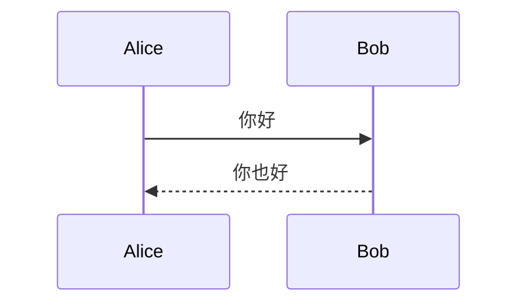

# md-2-pdf

把 Markdown 转成 PDF 的小工具，专门为下面三个场景优化：

- 中文文档（自动用 Noto / PingFang / 微软雅黑等 CJK 字体）
- Mermaid 图（`sequenceDiagram` / `stateDiagram` / `flowchart` 等都能渲染成矢量图）
- GitHub 风格的 Markdown + 代码高亮

底层方案：`markdown-it` 解析 + Mermaid.js 渲染 + 系统已装的 Chrome（Puppeteer 远控）打印 PDF。**不下载 Chromium**，直接用系统现成浏览器，跨 Linux / macOS。

---

## 一、快速使用

```bash
# 1. 进入目录
cd ~/ai/brain/skills/md-2-pdf

# 2. 转换（首次会自动 npm install，约 30 秒）
./md2pdf.sh path/to/your.md
# → 输出到 path/to/your.pdf

# 指定输出路径
./md2pdf.sh path/to/your.md path/to/custom.pdf
```

### 任意目录调用

把脚本路径加到 PATH，或者建一个软链：

```bash
ln -s ~/ai/brain/skills/md-2-pdf/md2pdf.sh ~/bin/md2pdf
# 之后任何目录：
md2pdf ./xxx.md
```

---

## 二、依赖与环境

| 依赖 | 必需性 | 说明 |
|---|---|---|
| Node.js ≥ 18 | 必需 | 项目用了 ES Module |
| npm | 必需 | 首次安装依赖用 |
| Google Chrome / Chromium / Edge | 必需 | 系统已装即可，无需额外下载 |
| CJK 字体（Noto CJK / PingFang / 微软雅黑） | 强烈建议 | 没有会显示成方块字 |

### Chrome 路径自动探测顺序

**Linux**：
1. `$CHROME_PATH` 环境变量（如果设置了）
2. `/usr/bin/google-chrome`
3. `/usr/bin/google-chrome-stable`
4. `/usr/bin/chromium`
5. `/usr/bin/chromium-browser`
6. `/snap/bin/chromium`
7. `/opt/google/chrome/chrome`

**macOS**：
1. `$CHROME_PATH` 环境变量
2. `/Applications/Google Chrome.app/Contents/MacOS/Google Chrome`
3. `/Applications/Google Chrome Canary.app/...`
4. `/Applications/Chromium.app/...`
5. `/Applications/Microsoft Edge.app/...`

如果都找不到，会在控制台报错。这时设环境变量手动指定：

```bash
CHROME_PATH=/your/custom/chrome ./md2pdf.sh xxx.md
```

---

## 三、支持的 Markdown 语法

直接用 `markdown-it` + GFM 配置，覆盖：

- 标题 1-6 级、段落、加粗、斜体、删除线
- 有序 / 无序列表（嵌套）
- 表格（GFM 表格）
- 代码块（语法高亮，基于 highlight.js GitHub 主题）
- 引用块（`>` 风格）
- 链接 / 图片（图片会自动按页宽缩放）
- 水平分割线
- 行内 HTML
- **Mermaid 图**：用 ` ```mermaid ` 围栏代码块，会被替换成 `<div class="mermaid">` 并由 Mermaid.js 渲染

### Mermaid 例子

````markdown

````


> 网络受限的环境注意：Mermaid 走 jsdelivr CDN。如果机器不能访问公网，渲染会失败。

---

## 四、样式定制

样式集中在 `convert.mjs` 的 `buildHtmlTemplate()` 函数里，包括：

- 字体（CJK 优先 Noto → PingFang → 微软雅黑）
- 行距 1.7、字号 11pt（适合 A4 纸打印）
- 页边距 18mm × 14mm
- 表格 / 代码块 / 时序图都加了 `page-break-inside: avoid`，尽量避免被分页切断

要改样式，直接编辑 `convert.mjs` 里 `<style>` 块即可，所见即所得。

---

## 五、目录结构

```
md-2-pdf/
├── README.md          # 本文档
├── md2pdf.sh          # bash 入口（推荐用这个调用）
├── convert.mjs        # 主转换脚本（Node.js）
├── package.json       # npm 依赖声明
├── .npmrc             # 跳过 puppeteer 下载 Chromium 的配置
└── node_modules/      # 首次运行后自动生成
```

---

## 六、常见问题

### Q1. 首次运行卡在 `npm install`？

国内网络访问 npm 官方源较慢，可临时切换淘宝镜像：

```bash
cd ~/ai/brain/skills/md-2-pdf
npm install --registry=https://registry.npmmirror.com --no-audit --no-fund
./md2pdf.sh xxx.md
```

### Q2. 报错 `Cannot find Chrome/Chromium`

参考"二、Chrome 路径自动探测顺序"，要么装一个 Chrome / Chromium，要么用 `CHROME_PATH` 显式指定。

### Q3. 中文显示成方块

系统缺中文字体。装一份：

- **Ubuntu/Debian**：`sudo apt install fonts-noto-cjk fonts-noto-cjk-extra`
- **CentOS/Fedora**：`sudo dnf install google-noto-cjk-fonts`
- **macOS**：自带 PingFang，无需安装

### Q4. 表格被分页切到两页

`convert.mjs` 里给 `table` 加了 `page-break-inside: avoid`，但如果表格本身就超过一整页高度，Chrome 仍会强制切分。这种情况要么减少表格行数，要么删掉那条 CSS 让它允许跨页。

### Q5. Mermaid 图渲染失败 / 显示为代码块

- 检查网络能否访问 `https://cdn.jsdelivr.net/npm/mermaid@10.9.1/dist/mermaid.min.js`
- 如果在内网，可把 mermaid.js 下载到本地，把 `convert.mjs` 里的 CDN 链接改成本地路径
- 检查 Mermaid 语法本身是否合法（在 <https://mermaid.live/> 先试一下）

### Q6. 想把它做成系统命令

```bash
# 方案 A：软链到 ~/bin（PATH 里包含 ~/bin 时）
ln -s ~/ai/brain/skills/md-2-pdf/md2pdf.sh ~/bin/md2pdf

# 方案 B：alias
echo 'alias md2pdf="~/ai/brain/skills/md-2-pdf/md2pdf.sh"' >> ~/.bashrc
source ~/.bashrc
```

---

## 七、典型用法示例

```bash
# 转换一份设计文档
./md2pdf.sh ~/ai/temp/智能体-定制版.md

# 批量转换某目录下所有 md
for f in ~/docs/*.md; do
  ./md2pdf.sh "$f"
done

# 用自定义 Chrome（如 Edge）
CHROME_PATH=/usr/bin/microsoft-edge ./md2pdf.sh xxx.md
```
